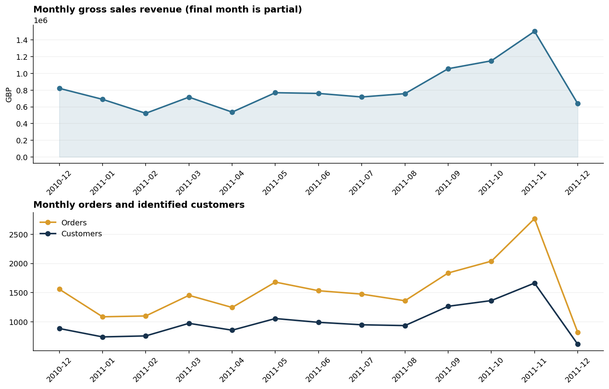

# Online Retail Customer Intelligence

一个可复现、可审计、可用于数据分析岗位 Portfolio 的端到端项目。项目使用 UCI 的真实电商交易数据，将 **541,909 行原始流水**转化为 SQLite 分析层、RFM 客户分群、月度 Cohort 留存、市场/商品分析、后续实验可行性评估、静态图表和一个无需服务器的交互式 Dashboard。

[查看完整分析报告](reports/analysis_report.md) · [查看后续实验方案](reports/experiment_plan.md) · [打开交互式 Dashboard](dashboard/index.html) · [查看 SQL](sql/analysis.sql) · [查看数据质量审计](outputs/data_quality.json)



## 为什么做这个项目

参考 [`zero2DA`](https://github.com/ranxi2001/zero2DA) 的 Final Project 规划，本项目覆盖完整 Portfolio 流程：真实数据获取 → 问题定义 → 清洗和质量检查 → SQL/Python 分析 → RFM 与 Cohort 深入分析 → 可视化/Dashboard → 专业报告 → 可复现验证。

核心业务问题：

1. 收入、订单和客户规模如何变化？
2. 哪些客户值得保留、培育或召回？
3. 新客在首购后是否持续购买？
4. 收入是否依赖少量客户、市场或商品？
5. 取消交易、匿名客户和不完整月份会怎样影响分析口径？

## 已验证结果

以下结果来自仓库内流水线的实际运行，不是示例数字：

| 指标 | 结果 | 口径 |
|---|---:|---|
| 有效销售毛额 | £10,642,110.80 | 排除取消单、非正数量和非正单价 |
| 有效订单 | 19,960 | 唯一 `InvoiceNo` |
| 可识别客户 | 4,338 | 有 `CustomerID` 的有效销售 |
| 平均订单金额 | £533.17 | 有效销售毛额 / 有效订单 |
| 复购客户占比 | 65.6% | 至少 2 个有效订单 |
| Top 10% 客户收入占比 | 61.5% | 仅可识别客户销售 |
| 非英国收入占比 | 15.4% | 有效销售毛额 |
| 第 3 月 Cohort 留存 | 25.6% | 观察窗口完整的 Cohort 加权 |

主要发现：

- 收入高度集中：Top 10% 可识别客户贡献 61.5% 的客户销售额。
- `Champions` 共 1,118 人，贡献 65.9% 的可识别客户收入；`At Risk` 共 373 人，可形成明确召回队列。
- 可识别客户交易覆盖 83.5% 的有效销售毛额，因此 RFM/Cohort 结论不代表匿名订单。
- 荷兰是英国以外收入最高市场；但数据没有履约成本、税费，不能直接推断海外利润。
- 销售额最高“商品”包含 `DOTCOM POSTAGE` 等服务型编码，业务看板应将邮费/调整项与实体商品分开治理。

## 数据口径与质量控制

- 数据源：Daqing Chen, [Online Retail](https://archive.ics.uci.edu/dataset/352/online+retail), UCI Machine Learning Repository, DOI [`10.24432/C5BW33`](https://doi.org/10.24432/C5BW33)，CC BY 4.0。
- 时间范围：2010-12-01 至 2011-12-09；最后一个月只有 9 天，不能与完整月份直接比较。
- 原始数据含 5,268 条完全重复行、135,080 条缺失客户编号记录和 9,251 条取消发票行。
- 销售毛额 = `Quantity × UnitPrice`，不是利润；数据没有成本、税费、运费拆分、库存和营销触达。
- 取消金额是取消行负金额的绝对值，未逐笔匹配原订单，不能表述为已确认退款额。
- 流水线执行 8 项校验，包括固定源行数/日期范围、SQL 与 Pandas 收入/订单/客户对账、RFM 全覆盖和 Cohort M0=100%。

## 一键复现

Python 3.11+：

```bash
python -m venv .venv
# Windows: .venv\Scripts\activate
# macOS/Linux: source .venv/bin/activate
pip install -r requirements.txt
python run_project.py
pytest
```

`run_project.py` 会从 UCI 官方源下载约 22.6 MB 的工作簿（若本地不存在），然后重建所有分析结果。原始数据和本地 SQLite 文件不会提交到 Git。

也可以分步运行：

```bash
python src/download_data.py
python -m src.pipeline
pytest
```

## 项目结构

```text
.
├── dashboard/
│   ├── index.html              # 已生成的离线交互式 Dashboard
│   └── template.html           # 无外部 JS 依赖的 Dashboard 模板
├── data/                       # 数据说明；raw 文件不入 Git
├── experiments/
│   └── experiment_registry.json # 四个实验的预注册式定义
├── outputs/                    # KPI、质量审计和可复核明细 CSV
├── reports/
│   ├── analysis_report.md      # 中文专业分析报告
│   ├── experiment_plan.md      # 实验设计、功效与停止规则
│   └── figures/                # 7 张分析与实验规划图
├── sql/analysis.sql            # SQLite 视图和业务查询
├── src/
│   ├── download_data.py        # 官方数据下载与校验
│   ├── experiments.py          # 时间切分、功效分析与模拟分流
│   └── pipeline.py             # 清洗、分析、对账、制图和报告生成
├── tests/                      # 分析与实验层单元测试
├── run_project.py              # 一键重建入口
└── requirements.txt
```

## 分析方法

- **SQL 分析层**：把去重后的交易行写入 SQLite，创建 `valid_sales_lines` 与 `customer_sales_lines` 视图；关键 KPI 与 Pandas 独立计算并对账。
- **RFM 分群**：以数据末日后一日为快照，按 Recency/Frequency/Monetary 五分位打分，映射为 Champions、Loyal、Potential Loyalists、New、At Risk、Hibernating 和 Needs Attention。
- **Cohort 留存**：按客户首购月分组，计算首购后 M0-M12 的月度购买留存；汇总指标只纳入观察窗口已达到目标月的 Cohort。
- **实验可行性**：用历史时间切分估计自然基线，通过二项比例功效分析计算样本量/MDE，并在价值、Recency、获客月或国家分层内生成确定性模拟分流。
- **Dashboard**：纯 HTML/CSS/JavaScript，数据内嵌、无 CDN，可离线打开并切换趋势和分群指标。

## 产出物

- [完整分析报告](reports/analysis_report.md)：背景、口径、结果、建议和限制。
- [交互式 Dashboard](dashboard/index.html)：月度趋势、RFM、Cohort、海外市场和商品榜。
- [数据质量审计](outputs/data_quality.json)：源规模、缺失、重复、取消行和验证结果。
- [核心 KPI](outputs/kpis.json) 及 [全部分析明细](outputs/)：便于复核或连接 BI 工具。
- [静态图表](reports/figures/)：适合 README、汇报或面试讲解。

## 后续实验层

项目已将分析建议扩展为四个预注册式实验方案，并使用 **2011-09-10** 时间切分：此前交易只用于定义人群，之后 30/90 天只用于估计历史自然基线，避免未来信息泄漏。

| 实验 | 历史基线 | 可用人群 | 检测 +5pp 所需总样本 | 当前可检测提升 |
|---|---:|---:|---:|---:|
| Champions 保护 | 83.3% | 893 | 1,528 | 6.4pp |
| At Risk 分批召回 | 22.4% | 272 | 2,348 | 15.5pp |
| 首购后 30/60/90 天运营 | 43.7% | 2,485 | 3,120 | 5.6pp |
| 海外头部市场验证 | 54.9% | 91 | 3,068 | 27.1pp |

当前四个单期样本池都不足以稳定检测 +5 个百分点提升，因此定位为**实验管线与运营试点**，不能提前宣称业务提升。完整方案包含：

- 分层随机、同期控制组、At Risk 三批执行与 Intent-to-Treat 分析；
- 主指标、次指标、取消/退订/投诉/补贴成本护栏及停止规则；
- 30/60/90 天历史自然二购基线（18.3% / 33.0% / 43.7%）；
- 海外市场门槛：德国、法国可做客户级随机试验；高集中或小样本市场先做测量准备；
- 哈希化客户号的[模拟分流预览](outputs/experiment_assignment_preview.csv)和[实验注册表](experiments/experiment_registry.json)。

这里的“基线”和“分流”都不是实际触达或实验结果。只有未来接入真实 assignment、delivery、conversion、成本与护栏事件后，才能估计增量效果。

## 决策建议与边界

建议按[后续实验方案](reports/experiment_plan.md)先做埋点、分流和小规模运营验收，再滚动积累到目标样本量。所有现有结论仍是历史描述性分析；没有真实随机触达日志，不能把观察到的差异写成因果效果，也不能声称这些建议已经带来 GMV 提升。
