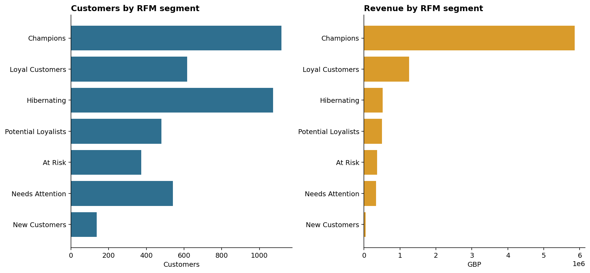
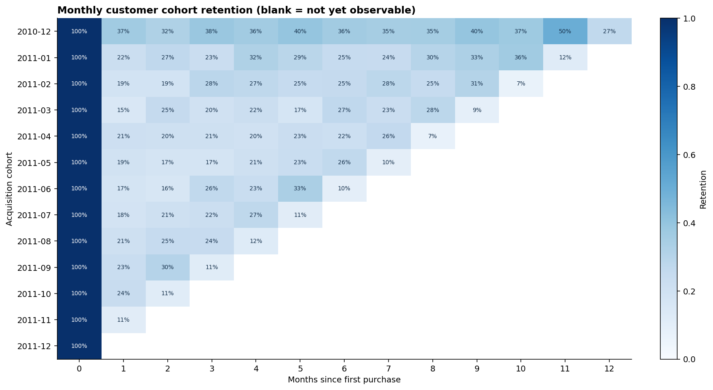
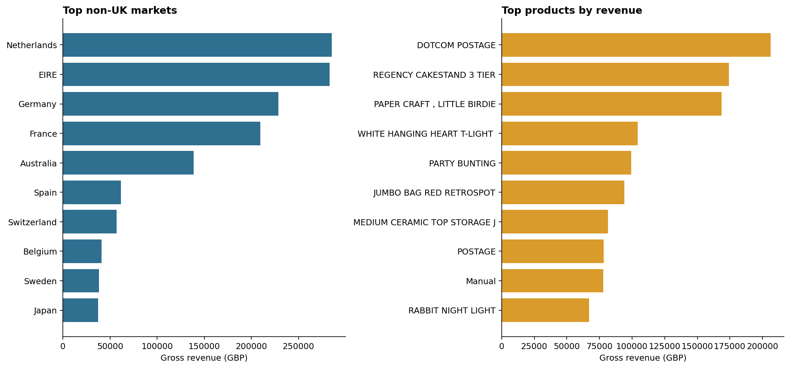
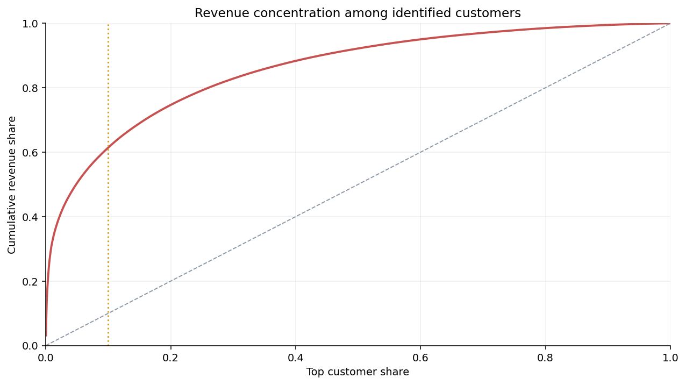

# UCI Online Retail 客户价值与留存分析报告

## 1. 业务背景与问题

本项目把一家英国无实体店礼品零售商的真实交易流水，转化为可回答运营问题的分析资产。目标不是预测未来，而是回答：收入从哪里来、哪些客户值得差异化运营、客户是否持续复购、取消交易如何影响口径，以及海外市场和商品组合有哪些机会。

## 2. 数据与口径

- 数据源：UCI Online Retail，原始 541,909 行，时间范围 2010-12-01 至 2011-12-09。
- 清洗：删除 5,268 条完全重复行；销售口径排除取消单、非正数量和非正单价。
- 收入口径：`quantity × unit_price` 的销售毛额（GBP），不是利润，也不含成本、税费和运费。
- 客户分析：仅使用有 `CustomerID` 的有效销售；这些交易覆盖销售毛额的 83.5%。
- 取消金额：按取消行负金额的绝对值估算，仅用于规模监控；未逐笔匹配原始订单，不能当作已确认退款额。
- 2011-12 只有前 9 天，月度比较时视为不完整月份，不与完整月份直接比较。

## 3. 核心结果

| 指标 | 结果 |
|---|---:|
| 有效销售毛额 | £10,642,110.80 |
| 有效订单 | 19,960 |
| 可识别客户 | 4,338 |
| 平均订单金额 | £533.17 |
| 复购客户占比 | 65.6% |
| 取消单数量 | 3,836 |
| 取消行金额绝对值 | £893,979.73 |
| Top 10% 客户收入占比 | 61.5% |
| 非英国收入占比 | 15.4% |
| 加权第 3 月留存 | 25.6% |
| 加权第 6 月留存 | 27.2% |

## 4. 图表解读

### 4.1 月度收入、订单与客户趋势

- 在完整月份中，2011-11 的销售毛额最高，为 £1,503,866.78，对应 2,769 个订单和 1,664 位可识别客户。9—11 月收入、订单和客户数同步走高，说明旺季增长不只是少数大额订单推动。
- 这张图只能证明时间上的共同变化。数据没有促销、流量和节假日活动字段，因此不能把增长归因于某次营销活动或单一季节因素。
- 2011-12 仅覆盖前 9 天，图中末点明显回落属于观察窗口不完整，不能与完整月份直接比较。

### 4.2 RFM 客户分层

- Champions 占可识别客户的 25.8%，却贡献 65.9% 的客户收入，是保护留存和服务体验的第一优先级。
- At Risk 与 Hibernating 客户池较大，但历史价值和近期活跃度不同，应将 At Risk 放入分批召回试验，而不是对所有沉睡客户统一发券。
- RFM 是基于最近购买、购买频次和累计消费的规则分层，不是响应概率模型；分群差异不能直接解释为某种运营动作的效果。

### 4.3 Cohort 月度留存

- 每行代表一个首购月份，M0 固定为 100%；空白格表示该 Cohort 尚未走到相应观察月，并非留存率为 0。
- 加权第 3 月和第 6 月留存分别为 25.6%、27.2%。两个汇总值纳入的可观察 Cohort 不完全相同，不能据其大小直接判断留存自然回升或下降。
- 图中没有营销曝光或随机分组信息，只能作为历史基线和异常监控依据，不能当作触达带来的因果提升。

### 4.4 海外市场与头部行项目

- Netherlands 以 £285,446 位居非英国市场首位，但海外市场是否值得扩张仍需结合运费、税费、交付时长和本地履约成本。
- 收入最高行项目为 `DOTCOM POSTAGE`（£206,249），它属于邮费编码而非实体商品。商品榜在用于选品或备货前，必须先拆分邮费、手工调整等服务型编码。
- 横轴是销售毛额而非利润；图中排名不能直接代表市场盈利能力或商品毛利贡献。

### 4.5 客户收入集中度

- 曲线明显高于均等分布虚线，收入最高的 10% 可识别客户贡献 61.5% 的客户销售额，说明高价值客户保护会影响较大的收入盘子。
- 高集中度同时意味着客户流失风险集中，应跟踪头部客户留存并设置服务护栏；但集中度本身不能证明提供权益后一定会提高收入。

## 5. 综合发现

1. **客户价值高度集中。** 收入最高的 10% 可识别客户贡献 61.5% 的客户销售额，运营应优先保护高价值客户，同时监测过度依赖风险。
2. **RFM 分层可以直接转成运营队列。** Champions 有 1,118 人，贡献 65.9% 的客户收入；At Risk 有 373 人，适合设置召回优先级。
3. **留存需要按 Cohort 持续追踪。** 加权第 3 月和第 6 月留存分别为 25.6%、27.2%；两者纳入的可观察 Cohort 不完全相同，不能把大小差异解释成自然回升或下降，也不能直接归因于营销动作。
4. **海外收入仍是补充市场。** 非英国市场贡献 15.4% 的有效销售额；其中 Netherlands 以 £285,446 位居海外市场首位。
5. **头部行项目需要先做商品治理。** 收入最高行项目为 `DOTCOM POSTAGE`（£206,249），但它是邮费编码而非实体商品；分析利润和备货前必须分离邮费、手工调整等服务型编码，并补充成本和库存数据。

## 6. 后续实验层

项目已把建议扩展为四个可复现实验设计：Champions 保护、At Risk 分批召回、首购后 30/60/90 天运营和海外头部市场验证。使用 2011-09-10 时间切分估计自然基线、样本量与可检测提升，并生成哈希化模拟分流预览；**这些不是已执行实验或因果结果**。完整方案见 [`reports/experiment_plan.md`](experiment_plan.md)。

## 7. 建议与下一步

- 为 Champions 建立服务保障和新品优先触达，对 At Risk 采用分批召回；以增量实验而不是活动后自然波动评估效果。
- 建立首购后 30/60/90 天自动化触达与 Cohort 看板，按获客月份追踪留存，避免只看累计复购率。
- 将取消单按商品、客户和月份建立原因码；当前数据没有取消原因，无法区分缺货、客户反悔、录入纠错等机制。
- 针对海外头部市场补充履约成本、税费、交付时长后再评估扩张；本项目只有销售额，没有利润字段。
- 后续如取得营销触达、流量、成本和库存数据，可增加漏斗、CAC/LTV、毛利与库存周转分析。

## 8. 证据与可复现材料

- SQL 定义：[`sql/analysis.sql`](../sql/analysis.sql)
- 交互式 Dashboard：[`dashboard/index.html`](../dashboard/index.html)
- 数据质量审计：[`outputs/data_quality.json`](../outputs/data_quality.json)
- 核心指标：[`outputs/kpis.json`](../outputs/kpis.json)
- Cohort、RFM、市场和商品明细：[`outputs/`](../outputs/)
- 实验可行性与分流预览：[`outputs/experiment_feasibility.csv`](../outputs/experiment_feasibility.csv)、[`outputs/experiment_assignment_preview.csv`](../outputs/experiment_assignment_preview.csv)
- 实验注册表：[`experiments/experiment_registry.json`](../experiments/experiment_registry.json)

## 9. 限制

这是公开历史交易数据的描述性分析。数据没有流量、营销触达、商品成本、库存、运费和取消原因，无法计算转化率、获客成本、真实利润，也不能把相关性写成因果结论。缺失客户编号的交易不进入 RFM/Cohort，客户相关结论只代表可识别客户。
